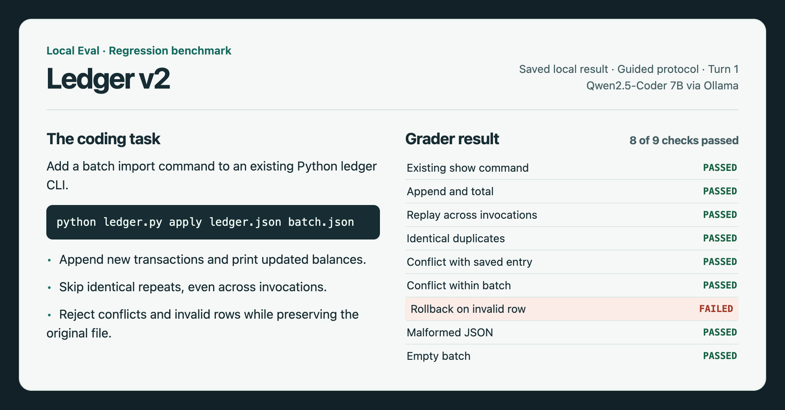
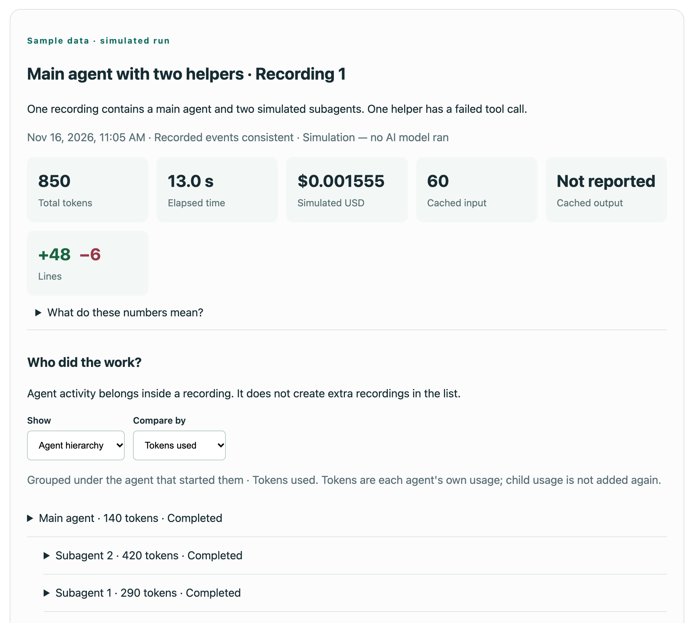

<div align="center">
  <h1>Local Eval</h1>
  <p><strong>Help developers understand how their coding agents spend time and tokens.</strong></p>
  <p>Record agent metrics locally, inspect each run in a Finish report, and compare model behavior on repeatable tasks.</p>
  <p>
    <a href="https://github.com/araskachoi/eval/actions/workflows/tests.yml"></a>
    
    
  </p>
  <p><a href="#model-regression">Model regression</a> · <a href="#eval-reporting-test">Eval reporting test</a> · <a href="#quick-start">Quick start</a> · <a href="#tests">Tests</a></p>
  
  <p><sub>Ledger v2 task and grader output from a saved local run on synthetic transactions.</sub></p>
</div>

## Model regression

Use model regression to see whether a candidate model succeeds more or less often than a baseline on the same coding task. Run both with matching benchmark settings, then use Local Eval to compare paired trials. It reports how many trials pass on the first submission and how many pass by the end of the repair budget. A gain in either count with no drop in the other is an improvement. A drop with no gain is a regression.

The eval runs the submitted code against synthetic fixtures in a fresh, network-disabled container for each check. The grader compares exit status, output, and resulting files with the expected behavior. A submission passes when **every required check passes**. [How comparisons work](regression/README.md#compare-saved-results)

In **Ledger v2**, the model adds `apply LEDGER BATCH` to an existing Python CLI. The nine checks cover these behaviors:

- Keep the existing `show` command compatible and print the correct balances after appending new transactions.
- Skip identical transactions within a batch and when replaying a batch in a separate invocation.
- Reject conflicting IDs, invalid rows, and malformed JSON with a nonzero exit status and the original ledger byte-for-byte intact.
- Accept an empty batch and print the existing balances. [Benchmark prompt](regression/benchmarks/ledger-v2/prompt.md)

In the saved local run, Qwen2.5-Coder 7B through Ollama passed **8 of 9** checks on its first submission. It failed the case where a valid transaction precedes a row with a boolean amount. The grader expects that entire batch to be rejected and the ledger to remain intact.

With the model installed in Ollama and the [grading environment set up and running](docs/regression-setup.md), save a run spec as `ledger-run.json`:

```json
{"benchmark":"ledger-v2","protocol":"guided","harness":"ollama","model":"qwen2.5-coder:7b","trials":1}
```

Run the trial from the source checkout:

```sh
python3.14 -B -m codex_eval regression run --spec ledger-run.json \
  --output regression/results/ledger-demo
```

## Eval reporting test

This reporting test feeds the collector scripted events for a main agent and two subagents. It checks that the Finish report counts **850 total tokens** once, attributes **140 tokens** to the main agent’s own work, and records **one failed tool call**. Token and line counts are scripted, and the displayed cost uses simulated rates. The test makes zero model calls.



See the [test assertions](tests/test_core.py#L221) and the [acceptance walkthroughs](docs/acceptance.md) for the other reporting scenarios.

## Quick start

From a source checkout with Python 3.14 or newer, start the collector:

```sh
python3.14 -m codex_eval collector start
```

Keep it running. In a second terminal, use the command below to get a one-time code, then open [127.0.0.1:8765](http://127.0.0.1:8765) and enter that code.

```sh
python3.14 -m codex_eval panel
```

For recording controls in Codex, install the Record skill using the [setup guide](docs/quickstart.md), then use `$record` and `$record stop` in the same chat. A fresh collector starts with an empty recording list. Recording usage requires explicitly correlated events from a trusted emitter. Automatic live Codex capture is unavailable.

## What it does

- **Review recordings.** See elapsed time, reported token usage, tool failures, and recorded checks. Compare subagents by their own usage and follow multiple recording windows for the same task.
- **Save a report.** Use the CLI to export an offline HTML Finish report. The collector stores normalized metrics locally. See the [event contract](docs/interfaces.md) for the fields it accepts.
- **Run controlled benchmarks.** Run ledger and filesystem tasks with the Codex CLI or Ollama, grade results in isolation, and compare runs. See [benchmark setup](docs/regression-setup.md) and [available benchmarks](regression/README.md).

## Tests

Run the host tests used by CI with Python 3.14:

```sh
TMPDIR="$(cd "${TMPDIR:-/tmp}" && pwd -P)" PYTHONPATH=tests python3.14 -B -m unittest \
  test_cli_events test_http test_models test_record test_summary
```

These tests exercise the collector, recording controls, event parsing, and reports. See the [isolated test setup](docs/security.md#development-provisioning) for the full suite.
